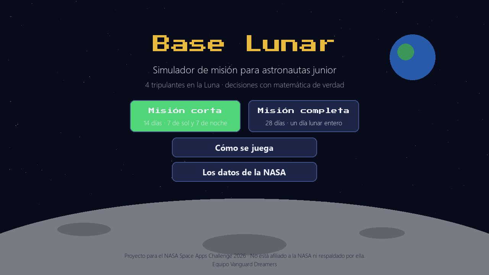
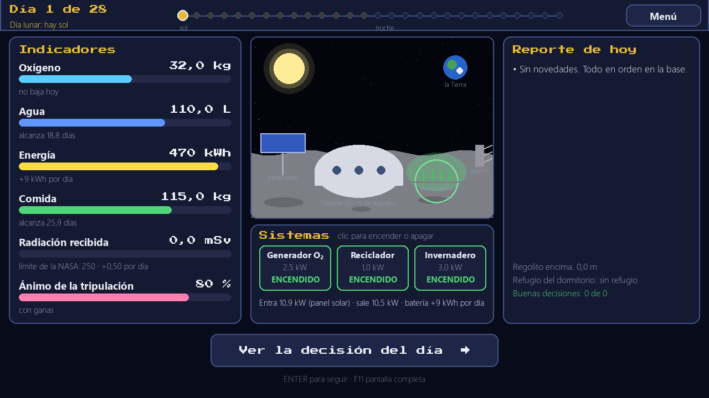
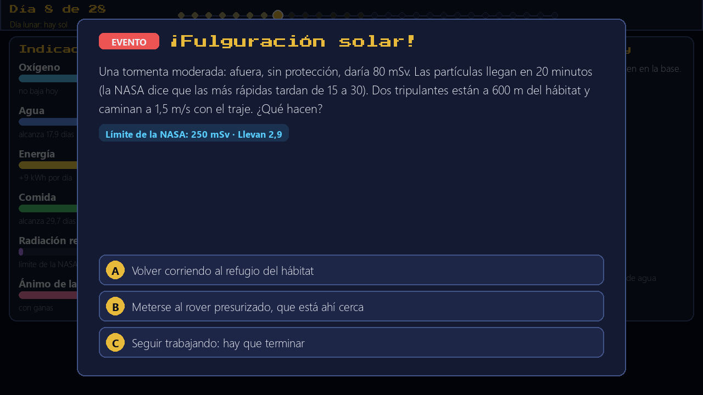

# NASA_SpaceApps_2026_Vanguard_Dreamers
Proyecto para presentar el dia domingo 15 de noviembre.

# Base Lunar

**Junior astronaut mission simulator · Simulador de misión para astronautas junior**
NASA Space Apps Challenge 2026 · Team Vanguard Dreamers



---

## English

Kids aged 7 to 12 run a lunar outpost with 4 crew members for 14 or 28 days. They balance **oxygen, water,
energy, food, radiation dose and crew morale**. Every day brings a decision that is a **real math problem with
real NASA numbers**, and every choice has consequences.

- **Two missions.** The full one lasts 28 days: one whole lunar day, 14 of sunlight and 14 of night. The short
  one lasts 14 days: the last 7 of sunlight and the first 7 of night.
- **17 different decisions.** Their numbers come from the state of the base at that moment. Examples: will
  the crew reach the shelter before the solar particles (distance ÷ speed against a 15–30 minute warning)?
  What should be switched off when night falls and the 10 kW reactor can't power everything?
- **Explained afterwards.** After each decision the game shows the math, so the player sees why the best
  option is the best.
- **Daily tasks are minigames** (mouse only, with sound): watering the greenhouse, aiming the solar panels at
  the Sun, covering the habitat with regolith, sealing oxygen leaks, drilling for ice, photographing Earth on
  the crew break and stowing the cargo rocket. Your score changes how much the task yields. The longer ones
  (35 to 45 s) adapt to the player: the level rises with good play, so a 7-year-old and an adult are both
  challenged.
- **English and Spanish.** Switch the language on the title screen.
- **Real space weather from NASA DONKI.** Every solar storm in the game is based on a real flare recorded by
  NASA (its class and date), and the shielding decision shows the real Sun: **live** (last 30 days) when
  there is internet, or clearly labelled **saved data** when there isn't.
- **Real data, with sources.** Every real number is listed with its link in [DATOS_NASA.md](DATOS_NASA.md),
  and on the in-game "NASA data" screen.

### How to run it

Requires Python 3.10+ (tested with 3.13).

```
pip install -r requirements.txt
python main.py
```

On Windows you can also double-click `JUGAR.bat`. Keys: **F11** fullscreen · **ESC** back or quit ·
**F12** saves a screenshot to `~/.mision_lunar/capturas`.

### How to check it

```
python tools/verificar.py
```

It checks every decision, every minigame and the balance, and must end with **TODO OK**. A quick balance
test where the computer plays 200 missions in a few seconds:
`python tools/simular_misiones.py 200` (add `--corta` for the short mission).

**Not affiliated with or endorsed by NASA.** No NASA logos or branding are used.

---

## Español

Chicos de 7 a 12 años administran una base en la Luna con 4 tripulantes durante 14 o 28 días. Equilibran
**oxígeno, agua, energía, comida, radiación recibida y ánimo de la tripulación**. Cada día llega una decisión
que es un **problema de matemática con números reales de la NASA**, y cada decisión tiene consecuencias.



### Cómo se juega un día

1. **Mañana:** mirar los 6 indicadores y el reporte. Los sistemas se encienden y apagan con un clic.
2. **Decisión:** un problema con números reales. Después el juego explica las cuentas.
3. **Tarea:** regar el huerto, apuntar los paneles al Sol, cubrir el hábitat con regolito, sellar las fugas del
   oxígeno, perforar el hielo, tomarle fotos a la Tierra en el recreo o guardar la carga del cohete (la estiba).
   Cada una es un microjuego con sonido (se pueden apagar). Los largos (de 35 a 45 s) se adaptan a quien juega: el
   nivel sube si se juega bien, así un niño de 7 años y un adulto tienen cada uno su reto.
4. **Cierre:** la base consume y produce; se ve qué subió y qué bajó.

Se pierde si se acaba el oxígeno, el agua o la comida, si la radiación pasa el límite de la NASA (250 mSv) o
si el ánimo llega a cero.



### Cómo abrirlo

Hace falta Python 3.10 o más nuevo (probado con 3.13).

```
pip install -r requirements.txt
python main.py
```

En Windows también se puede dar doble clic a `JUGAR.bat`.

### Para el equipo: cómo hacer o mejorar un microjuego

Aquí están los nuestros: `oxigeno`, `hielo`, `recreo`, `estiba` y `huerto` (la cosecha). Los paneles
(`solaris/`) y el barrido de radiación (`barrido_orbital/`) los hizo el resto del equipo. Cada quien trabaja en
**su propio archivo** y el juego lo encuentra solo. La guía completa está en
[base_lunar/microjuegos/LEEME.md](base_lunar/microjuegos/LEEME.md).

1. Para uno nuevo, copiar `base_lunar/microjuegos/_plantilla.py` con otro nombre (por ejemplo `mi_juego.py`).
2. Llenar las 4 partes marcadas con **HACER**.
3. Probarlo solo: `python tools/probar_microjuego.py huerto`
4. Antes de subirlo: `python tools/verificar.py` tiene que decir **TODO OK**.

Los nuestros (`oxigeno`, `hielo`, `recreo`,
`estiba` y `huerto`) usan el kit `base_lunar/microjuegos/_kit.py`: cuenta regresiva, niveles que se adaptan, combo,
efectos y la tarjeta final con estrellas.

### Qué hay en cada carpeta

| Carpeta o archivo | Qué es |
|---|---|
| `main.py` · `JUGAR.bat` | Para abrir el juego |
| `base_lunar/simulador.py` | Las reglas de la base (sin pantalla) |
| `base_lunar/decisiones.py` | Las 17 decisiones con su matemática |
| `base_lunar/datos_nasa.py` | Los datos reales con su fuente |
| `base_lunar/juego.py` | Las pantallas |
| `base_lunar/microjuegos/` | La plantilla, el ejemplo y los microjuegos del equipo |
| `base_lunar/textos.py` · `textos_en.py` | Los textos: español y su traducción al inglés |
| `tools/` | Verificador, simulador del balance y probador de microjuegos |

**No está afiliado a la NASA ni respaldado por ella.** No usa sus logos ni su marca. Créditos en
[CREDITOS.md](CREDITOS.md).
